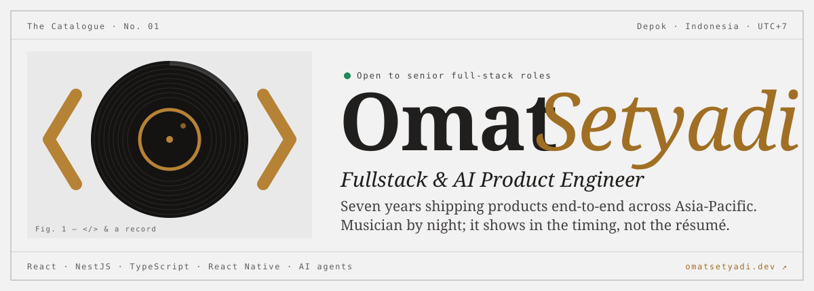

<a href="https://omatsetyadi.dev">
  <picture>
    <source media="(prefers-color-scheme: dark)" srcset="./assets/hero-dark.svg" />
    
  </picture>
</a>

  
  
  

---

### Liner notes

Fullstack & AI product engineer in Depok, Indonesia. Seven years shipping products end-to-end
for healthcare, hospitality and AI teams across Asia-Pacific, with products reaching **1M+ end users**.
These days I build AI agents, tool-calling and local-first assistants.

> **Now playing: Residency at Jitera (2024 → now).** Most of my day-to-day work lives in Jitera's
> private repos under my work account **[@omatsetyadii](https://github.com/omatsetyadii)**,
> so the contribution graph here only shows the side projects.

### Side B: personal tracks

| No. | Track | Liner note | Stack |
| --- | --- | --- | --- |
| 01 | **[Timmy](https://github.com/omatsetyadi/timmy)** | Modular, local-first personal AI assistant: core, SDK and optional modules | TypeScript |
| 02 | **[timmy-voice](https://github.com/omatsetyadi/timmy-voice)** | Speech ↔ text daemon; the core only ever sees text | Python |
| 03 | **[timmy-plugin-web](https://github.com/omatsetyadi/timmy-plugin-web)** | Web search and page fetch, multi-provider ready | TypeScript |
| 04 | **[timmy-plugin-shell](https://github.com/omatsetyadi/timmy-plugin-shell)** | Shell commands with read/mutate risk classification | TypeScript |
| 05 | **[tool-call-machine](https://github.com/omatsetyadi/tool-call-machine)** | Framework-agnostic OS and app-control operations for agents | TypeScript |
| 06 | **[agent-tool-calls](https://github.com/omatsetyadi/agent-tool-calls)** | Reusable tool implementations, zero agent-framework dependencies | TypeScript |

### Discography

| Year | Album | Label | Role |
| --- | --- | --- | --- |
| 2024 | *Agent Era* | Jitera Pte. Ltd. | Full Stack Engineer |
| 2022 | *Belanja Sessions* | SwipeRx · mClinica Pte. Ltd. | Associate Full Stack Developer |
| 2021 | *Document Layer* | PT Quadrant Synergy International | Front End Developer |
| 2020 | *Enterprise Cuts* | Multisoft | Full-stack / Backend Engineer |
| 2019 | *Independent* | Solo / Contract | Freelance Engineer |

Engineered for clients including Wondertable · Daicolo · Promax · Ishibashi Gakki · Impact Circle · Nestlé · Abbott · Manulife · KOMINFO.

### Credits

  

React Native on mobile · AI agents & tool-calling · Vercel · Cloudflare

---

<i>Musician by night; it shows in the timing, not the résumé.</i> 
Full catalogue at <a href="https://omatsetyadi.dev">omatsetyadi.dev</a>

